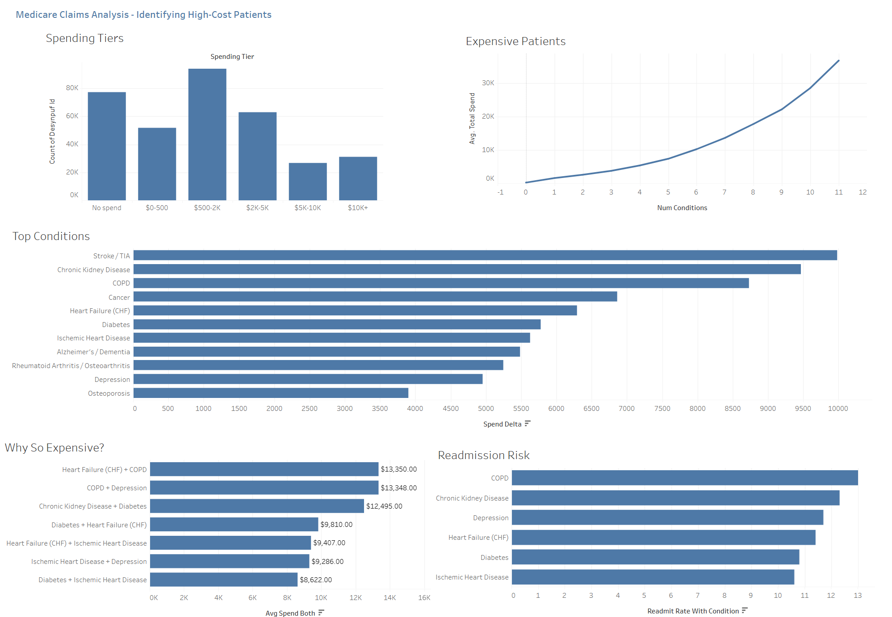

# Healthcare Claims Analytics

**[View Tableau Dashboard](https://public.tableau.com/app/profile/ajaiah.darlington/viz/HealthcareClaimsAnalyticsDashboard_17777471179890/HealthcareClaims-Summary)**



---

## What This Project Is

This project analyzes three years of Medicare claims data (2008–2010) to answer a question that matters in every healthcare organization: **who are the most expensive patients, why, and could we have seen it coming?**

The dataset — released publicly by the Centers for Medicare & Medicaid Services (CMS) — is fully synthetic, meaning it was computer-generated to mimic real Medicare patterns without containing any actual patient information. It covers roughly **116,000 beneficiaries** and includes their hospital stays, outpatient visits, and prescription drug fills.

The end result is a Tableau dashboard built on top of pre-computed, analysis-ready tables.

---

## Key Findings

All figures are produced by the notebooks in this repo and count **beneficiary-years** (one person in one calendar year), not unique people, unless stated otherwise.

### Most Medicare spending is concentrated in a small group of very sick people

The top 10% of beneficiary-years (those above **$8,927**) average **$22,356/year** and account for **62% of all spending**. The other 90% average **$1,531**. At the other end, 22% of beneficiary-years have no Medicare spending at all.

### Cost climbs steeply with the number of chronic conditions

| Number of Chronic Conditions | Avg Annual Medicare Spend |
|---|---|
| 0 | $268 |
| 3 | $3,798 |
| 6 | $10,274 |
| 11 | $36,829 |

Each additional condition adds more than the one before it: the step from 2 to 3 conditions adds about $1,200 a year, the step from 5 to 6 adds about $2,900.

### Some conditions carry a much heavier price tag than others — but less than the raw gap suggests

| Condition | % of Beneficiary-Years | Raw Gap (with − without) | Gap at Equal Comorbidity |
|---|---|---|---|
| Stroke / TIA | 4% | +$9,980 | +$4,573 |
| Chronic Kidney Disease | 17% | +$9,466 | +$5,927 |
| COPD | 13% | +$8,731 | +$4,289 |
| Cancer | 7% | +$6,859 | +$3,159 |
| Heart Failure (CHF) | 30% | +$6,291 | +$2,842 |
| Diabetes | 36% | +$5,778 | +$1,896 |

The **raw gap** is simply average spend with the condition minus average spend without it. It overstates each condition's own effect, because people with one chronic condition usually have several others. The **gap at equal comorbidity** compares people who have the same number of *other* conditions, and it is roughly two-thirds of the raw gap at most, and usually under half. On that fairer comparison, chronic kidney disease — not stroke — carries the largest cost. Neither number is a causal estimate.

### Certain pairs of conditions together are far more expensive

| Condition Pair | Avg Spend (Both) | Avg Spend (At Least One) | Avg Spend (Neither) |
|---|---|---|---|
| CHF + COPD | $13,350 | $7,859 | $1,472 |
| COPD + Depression | $13,348 | $7,978 | $1,910 |
| Kidney Disease + Diabetes | $12,495 | $7,337 | $1,139 |

A beneficiary-year with both CHF and COPD costs 9x one with neither.

### About 1 in 10 hospital stays is followed by a readmission within 30 days

**9.6%** of inpatient stays (6,421 of 66,705) are followed by another admission for the same patient 1–30 days after discharge. Stays by patients with a chronic condition are readmitted 1.5 to 2.5 times as often: 13.0% with COPD versus 6.3% without, and 12.3% with chronic kidney disease versus 5.5% without.

This is an all-cause rate. It does not remove planned readmissions the way the official CMS quality measure does, so it is not directly comparable to published hospital benchmarks.

---

## The Data

All data is **fully synthetic** — generated by CMS for public analytical use. No real patients are represented. The source files are available at the [CMS Data Entrepreneurs' Synthetic Public Use File (DE-SynPUF)](https://www.cms.gov/research-statistics-data-and-systems/downloadable-public-use-files/synpufs) page.

Four source files feed into the analysis:

| What It Contains | File | Rows |
|---|---|---|
| Hospital stays (inpatient) | `DE1_0_2008_to_2010_Inpatient_Claims_Sample_1.csv` | 66,773 |
| Doctor visits and outpatient care | `DE1_0_2008_to_2010_Outpatient_Claims_Sample_1.csv` | 790,790 |
| Prescription drug fills | `DE1_0_2008_to_2010_Prescription_Drug_Events_Sample_1.csv` | 5,552,421 |
| Patient demographics + annual spending + chronic condition flags | `DE1_0_200{8,9,10}_Beneficiary_Summary_File_Sample_1.csv` (one per year) | 343,644 |

Every table carries a synthetic patient ID (`DESYNPUF_ID`). Cost fields reflect what Medicare reimbursed — not what was billed. The findings above come from the inpatient and beneficiary tables; the outpatient and prescription tables are loaded and profiled but not yet analyzed at claim level.

> **Note on 2010 data:** Average spending and condition prevalence both appear lower in 2010 than in 2008–2009. This is a known artifact of the DE-SynPUF dataset — late-arriving claims for 2010 were not fully captured in the release, so that year appears artificially lean. Trend analysis using this dataset should treat 2010 with caution.

---

## How the Analysis Was Built

The project runs as a sequence of six Jupyter notebooks. Metric definitions that more than one notebook needs — the spend formula, the readmission rule, spending tiers, condition labels — live once in [`src/claims_metrics.py`](src/claims_metrics.py) and are covered by unit tests in [`tests/`](tests/).

### [01_setup.ipynb](notebooks/01_setup.ipynb) — Load everything into one place
Reads the source CSV files into a local SQLite database (`cms_data.db`). The three annual beneficiary files are stacked into one table with a `YEAR` column added. Each table is fully replaced on every run, so re-running never duplicates rows. Indexes are added on the join keys, including a unique index that enforces one beneficiary row per year.

**Why SQLite?** The raw files total ~600MB. SQLite keeps them in a single portable file, lets every notebook query with plain SQL, and avoids spinning up an external database server for a self-contained analytical project.

### [02_eda.ipynb](notebooks/02_eda.ipynb) — Understand what you have before you analyze it
Inspects each table: row counts, data types, missing values, and cost distributions. It then runs a set of data quality checks. Assumptions the later notebooks depend on are written as assertions that stop the notebook if they fail.

**What was found:** Keys are unique, chronic condition flags are consistently coded (1 = has condition, 2 = does not), and every claim belongs to a known beneficiary. The data is not perfectly clean, though, and these quirks are handled explicitly downstream:

| Quirk | Count | How it is handled |
|---|---|---|
| Inpatient claims split across two rows (segments) | 68 | One row per stay (`SEGMENT = 1`) for readmissions |
| Inpatient claims with zero or negative payment | 2,215 | Excluded from cost-per-claim averages |
| Admissions dated before 2008 | 226 | No matching beneficiary year; left out of by-condition rates |
| Beneficiary-years with $0 or negative spend | 77,181 | Own "No spend" tier |
| Beneficiary-years with no Part A or B coverage | 16,314 | Kept; effect measured in a sensitivity check |

### [03_cost_analysis.ipynb](notebooks/03_cost_analysis.ipynb) — Where is the money going?
Identifies the highest-cost diagnoses (ICD-9 codes) and hospital procedure groups (DRGs), profiles the top 10% of spenders, and tracks spending by year.

### [04_readmissions.ipynb](notebooks/04_readmissions.ipynb) — Who keeps coming back?
Detects 30-day readmissions by sorting each patient's hospital stays chronologically and flagging any stay followed by a new admission 1–30 days after discharge. Computes readmission rates by diagnosis, by DRG, and by chronic condition status. A next admission on the discharge day is treated as a transfer, and overlapping stays are not counted.

**Why 30 days?** The 30-day window is the standard used by CMS for hospital quality reporting.

**Technical note:** Dates in the source data are stored as 8-digit integers (e.g., `20080315` for March 15, 2008). SQLite's `julianday()` returns NULL for that format, which made an early SQL version of this metric report a 0% readmission rate without raising an error. The readmission rule is now implemented twice — in pandas and in SQL that rebuilds a real date first — and `06_exports.ipynb` asserts that the two produce the same count before anything is exported.

### [05_chronic_conditions.ipynb](notebooks/05_chronic_conditions.ipynb) — How do multiple conditions interact?
Examines what happens when patients have combinations of conditions. Computes spending by total condition count, co-occurrence rates between conditions, the cost of specific high-risk pairs, and condition prevalence by year.

### [06_exports.ipynb](notebooks/06_exports.ipynb) — Package everything for Tableau
Pre-computes all final metrics and writes them to CSV files in `data/exports/`. Tableau is optimized for visualization, not heavy computation — by doing all aggregations in Python first, the dashboard stays fast and the logic stays auditable.

**Why two cost gaps per condition?** The raw with/without gap is easy to read but confounded by other conditions. The export also includes a gap computed within groups that have the same number of other conditions (`adjusted_spend_delta`), so the dashboard number can be shown next to a fairer one.

---

## The Dashboard

The Tableau dashboard has five charts built from four of the files in `data/exports/`. The workbook itself is included at [`dashboard/Healthcare-Claims-Analytics-Dashboard.twbx`](dashboard/Healthcare-Claims-Analytics-Dashboard.twbx) if you'd like to open it directly in Tableau Desktop/Public rather than just viewing the published version.

| Chart | File | What It Shows |
|---|---|---|
| Spending Tiers | `beneficiary_cohort.csv` | Count of beneficiary-years in each annual spending band |
| Expensive Patients | `beneficiary_cohort.csv` | Average spend by number of chronic conditions |
| Top Conditions | `condition_impact.csv` | Raw spending gap for each chronic condition |
| Why So Expensive? | `comorbidity_pairs.csv` | Average spend when both conditions in a pair are present |
| Readmission Risk | `readmission_by_chronic_condition.csv` | 30-day readmission rate for stays by patients with each condition |

> **Workbook status:** the packaged workbook and the screenshot above carry the current data. If the published Tableau Public version has not been republished since, it still predates two corrections: *Readmission Risk* (rates are 0.3–1.0 points higher after a join fix) and *Spending Tiers* (a new "No spend" band holds the 22% of beneficiary-years the chart previously left out).

The remaining exports support the findings above and are available for further views:

| File | Contents |
|---|---|
| `summary_statistics.csv` | Headline counts, total spend, overall readmission rate |
| `drg_summary.csv`, `readmission_by_drg.csv`, `readmission_rates_by_drg.csv` | Cost, length of stay and readmission rate per DRG |
| `diagnosis_summary.csv`, `readmission_rates_by_diagnosis.csv` | Cost and readmission rate per primary diagnosis |
| `spending_by_condition_burden.csv` | Spend distribution by number of conditions |
| `yearly_trends.csv`, `condition_progression_by_year.csv` | Spend and condition prevalence by year |
| `coverage_sensitivity.csv` | Average spend under stricter enrollment filters |
| `drg_cost_analysis.csv`, `diagnosis_cost_analysis.csv`, `chronic_condition_spend_impact.csv`, `dual_condition_combinations.csv`, `spending_trends_by_year.csv` | Top-20 and exploratory tables written by notebooks 03 and 05 |

---

## Limitations

- **Associations, not causes.** Every cost and readmission comparison is descriptive. The comorbidity-adjusted gap controls for the *number* of other conditions only, not which ones, nor age or sex.
- **Partial-year enrollment is not adjusted for.** A person enrolled for two months counts the same as one enrolled for twelve. Restricting to full-year Part A and B coverage raises average spend from $3,614 to $4,028 (`coverage_sensitivity.csv`).
- **Readmissions are all-cause** and include planned returns. Stays discharged in December 2010 cannot show a readmission because the data ends.
- **2010 is incomplete**, and pooled three-year averages include it.
- **Spend excludes** Part D drug costs and the beneficiary's own share.
- **Synthetic data.** DE-SynPUF preserves the structure of Medicare claims but not all real-world relationships between variables, so the numbers illustrate a method rather than describe real patients.

---

## Project Structure

```
Healthcare-Claims-Analytics/
├── notebooks/
│   ├── 01_setup.ipynb                 load CSVs → SQLite (cms_data.db), build indexes
│   ├── 02_eda.ipynb                   schema exploration, distributions, data quality checks
│   ├── 03_cost_analysis.ipynb         cost drivers by DRG, ICD-9, top spenders
│   ├── 04_readmissions.ipynb          30-day readmission detection and profiling
│   ├── 05_chronic_conditions.ipynb    comorbidity burden and cost
│   └── 06_exports.ipynb               final aggregates → data/exports/ for Tableau
├── src/
│   └── claims_metrics.py              shared metric definitions used by every notebook
├── tests/
│   └── test_claims_metrics.py         unit tests for the readmission, join, tier and gap logic
├── data/
│   ├── raw/                           source CSVs — not committed (see .gitignore)
│   └── exports/                       pre-aggregated CSVs for Tableau (beneficiary_cohort.csv
│                                       excluded for size — see Data Notes)
├── assets/
│   └── dashboard_screenshot.png       preview image used in this README
├── dashboard/
│   └── Healthcare-Claims-Analytics-Dashboard.twbx   the Tableau workbook
├── cms_data.db                        local SQLite database (~650MB) — not committed
├── COLUMNS_REFERENCE.md               data dictionary for all source fields
└── requirements.txt                   Python dependencies (pinned)
```

---

## How to Replicate This

**You will need:** Python 3.10+ (last run on 3.14), the source CSV files from CMS (linked above), and Tableau Desktop or Tableau Public.

**Step 1 — Install dependencies**
```bash
pip install -r requirements.txt
```

**Step 2 — Add the source data**

Download the DE-SynPUF Sample 1 files from CMS and place them in `data/raw/`. The expected filenames are listed in the Data section above.

**Step 3 — Run the tests**
```bash
python -m pytest tests
```

**Step 4 — Run the notebooks in order**

Open Jupyter and run notebooks `01` through `06` in sequence, or execute them from the command line:
```bash
cd notebooks
python -m nbconvert --to notebook --execute --inplace 0*.ipynb
```

- `01_setup.ipynb` must run first — it creates `cms_data.db` that all other notebooks depend on. It takes about a minute.
- Notebooks `02` through `06` each depend only on the database and can be run in any order after `01`.
- `02_eda.ipynb` and `06_exports.ipynb` stop with an assertion error if a data assumption or the readmission reconciliation fails.

**Step 5 — Open in Tableau**

Connect Tableau to the CSV files in `data/exports/`. Each file is self-contained and ready to use as a data source. No joins are required in Tableau — all aggregations are pre-computed.

---

## Tech Stack

| Layer | Tool | Why |
|---|---|---|
| Data storage | SQLite | Single portable file, no server required, full SQL support |
| Analysis | Python + pandas | Flexible, reproducible, straightforward date handling |
| Testing | pytest | Checks the metric logic on small hand-built cases |
| Notebooks | Jupyter | Combines code, output, and documentation in one place |
| Visualization | Tableau | Industry-standard dashboarding with fast, interactive filtering |

---

## Data Notes

- All data is **synthetic** — safe for public sharing and portfolio use.
- Beneficiary count drops slightly each year (116K → 115K → 113K) due to simulated deaths and disenrollment.
- Chronic condition flags use 1 = condition present, 2 = condition absent (not the intuitive 0/1 — handled explicitly in all calculations). Flags are annual, so a hospital stay takes its flags from the admission year.
- Total spend means Medicare reimbursement for inpatient, outpatient and carrier (physician) services.
- ICD-9 codes are used throughout (not ICD-10) — the dataset predates the 2015 ICD-10 transition.
- `data/exports/beneficiary_cohort.csv` (the patient-level export, ~27MB) is excluded from the repo via `.gitignore` to keep the repo lightweight. It's regenerated locally by `06_exports.ipynb` — every other file in `data/exports/` is committed.
